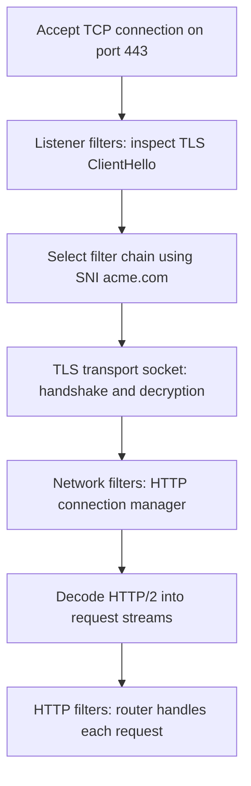

#envoy #listener #filter-chain
# Envoy: listener filters, network filter chains, and TLS

Based on [Life of a Request — Envoy v1.40.2](https://www.envoyproxy.io/docs/envoy/v1.40.2/intro/life_of_a_request).

## `listener_filters` versus `filter_chains`

“Filter chain” means an ordered series of filters. The YAML field `filter_chains` has a more specific meaning: alternative connection-handling configurations attached to a listener.

- **`listener_filters`**: an ordered pipeline run on a newly accepted connection, before network filter-chain selection. These filters inspect or modify connection information.
- **`filter_chains`**: candidate configurations. Envoy selects **one matching entry per connection**, rather than executing all entries sequentially.

Each `filter_chains` entry contains:

- `filter_chain_match`: criteria for selecting this entry, such as TLS SNI.
- `transport_socket`: transport handling for the selected connection, such as TLS.
- `filters`: the ordered **network filter chain**.

In the example, the TLS inspector extracts SNI and makes it available to `filter_chain_match.server_names: ["acme.com"]`. If no chain matches, Envoy uses `default_filter_chain` when configured; otherwise it closes the connection. The example has no default chain.

## TLS inspector versus TLS transport socket

**TLS inspector identifies the incoming connection; the TLS transport socket handles TLS.**

The listener filter `envoy.filters.listener.tls_inspector` inspects the initial TLS ClientHello to detect TLS and extract SNI and offered ALPN protocols, such as `h2`. It does **not** terminate TLS or decrypt application data.

After chain selection, that chain’s `envoy.transport_sockets.tls` transport socket performs the actual TLS handshake using its configured certificate/private key, decrypts incoming data, and encrypts outgoing data.

The `typed_config."@type"` values identify different Protobuf configuration messages:

- Inspector: `type.googleapis.com/envoy.extensions.filters.listener.tls_inspector.v3.TlsInspector`
- Downstream TLS transport: `type.googleapis.com/envoy.extensions.transport_sockets.tls.v3.DownstreamTlsContext`

These are type identifiers, not URLs Envoy fetches. They configure two separate extensions.

## Where is the network filter chain?

There is no `network_filter_chain:` YAML key. The network filter chain is **`filter_chains[i].filters`**, within the selected entry.

In the example, its only filter is `envoy.filters.network.http_connection_manager`. A single filter still constitutes a chain.

The HTTP connection manager decodes HTTP and creates a separate **HTTP filter chain for each request stream**, configured by its nested `http_filters` list. The example’s actual YAML lists only the HTTP router filter; its prose also describes a hypothetical CustomFilter.

## Incoming connection flow in the example

**SNI matching is not HTTP routing:** `filter_chain_match.server_names` matches TLS SNI at connection setup. `virtual_hosts.domains` matches HTTP `Host`/`:authority` later, per request.

## References

- [Listener filters and filter-chain matching](https://www.envoyproxy.io/docs/envoy/v1.40.2/intro/arch_overview/listeners/listener_filters.html)
- [TLS Inspector](https://www.envoyproxy.io/docs/envoy/v1.40.2/configuration/listeners/listener_filters/tls_inspector.html)
- [FilterChain API](https://www.envoyproxy.io/docs/envoy/v1.40.2/api-v3/config/listener/v3/listener_components.proto.html#envoy-v3-api-msg-config-listener-v3-filterchain)
